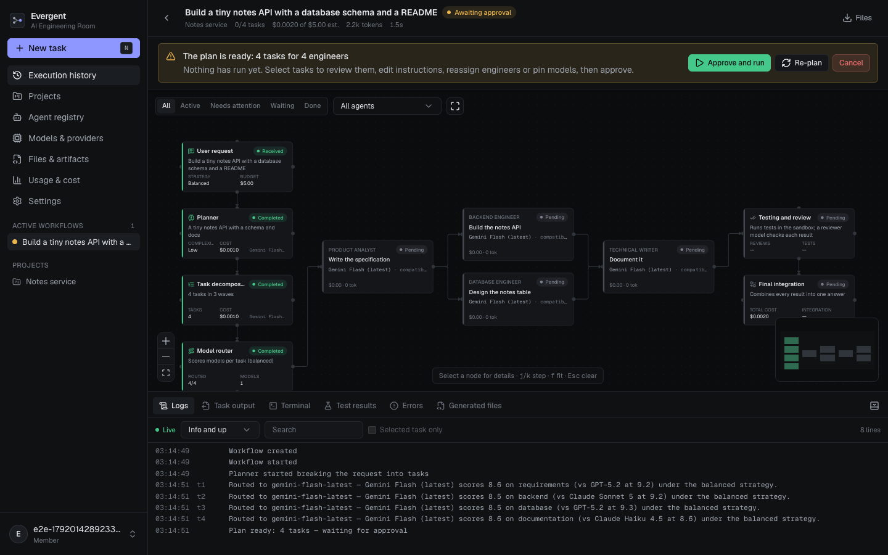

# Evergent — AI Engineering Room

Describe a piece of software. A planner turns it into a brief and a dependency
graph of tasks, a router picks the best available model for each task, a team
of specialised agents (backend, frontend, database, testing, security,
integration, …) does the work in parallel, generated tests run in an isolated
sandbox, a reviewer model checks every result, and a final integrator combines
everything into one deliverable. You watch it happen live on a canvas, approve
the plan before anything runs, and can inspect every decision, model call,
tool call, file and cost.



<sub>Screenshots in `docs/screenshots/` come from the automated end-to-end run,
where the model provider is scripted; with real providers the same screens
show the models that actually ran.</sub>

## What is in this repository

```
evergent/
├── backend/                 FastAPI · SQLAlchemy 2 · Alembic · Celery · pgvector
│   ├── app/api/v1/          REST + SSE endpoints
│   ├── app/services/        orchestrator (state machine, engine, events, recovery),
│   │                        model router, providers, agents, tools, sandbox, storage
│   ├── alembic/             migrations
│   └── tests/               pytest suite (+ tests/e2e/server.py for browser tests)
├── frontend/                Next.js 16 (App Router) · TypeScript · Tailwind · React Flow
│   ├── src/app/             pages, the /api/session login route and the /api/v1 proxy
│   ├── src/components/      workspace (canvas, inspector, console), pages, UI primitives
│   ├── src/lib/             typed API client (generated from OpenAPI), graph, events
│   └── tests/               Vitest unit/component tests, Playwright end-to-end tests
├── infrastructure/
│   ├── deployment/          DEPLOYMENT.md, RENDER_AND_VERCEL.md, BACKUP_AND_RESTORE.md, Caddyfile
│   ├── monitoring/          MONITORING.md
│   └── docker/              backup.sh, restore.sh
├── .github/workflows/ci.yml lint, types, tests, migrations, e2e, image builds
├── docker-compose.yml       the full stack, production-style
├── docker-compose.dev.yml   Postgres + Redis only, for local development
├── render.yaml              the API on Render (Postgres on Neon, frontend on Vercel)
└── .env.example             every setting, placeholders only
```

### How a request flows

```
browser ─▶ Next.js server ─────────────▶ FastAPI ─▶ PostgreSQL (+pgvector)
           • httpOnly session cookies     │  ▲         workflows, tasks, events,
           • /api/v1/* proxy adds bearer  │  │         executions, usage, audit
           • CSRF origin check            ▼  │ SSE (replayable)
                                        Redis ◀── worker (Celery)
                                                   planner → router → agents →
                                                   sandboxed tests → review →
                                                   final integration
```

The browser never holds a token or any server secret. Model provider keys live
in the backend's environment or, entered by an administrator, encrypted in the
database.

## Run it

### Everything in Docker

```bash
cp .env.example .env
# Fill in POSTGRES_PASSWORD, SECRET_KEY, ENCRYPTION_KEY (generators are in the
# file) and at least one provider key — or add the key later in the UI.
docker compose up -d --build
open http://localhost:3000
```

Sign-ins, sign-outs and other sensitive actions are recorded; see them under
**Settings → Security log** or with `python -m scripts.auth_log` (in Docker:
`docker compose exec api python -m scripts.auth_log -f`).

Create an account, then make it an administrator (needed to manage providers
and agents):

```bash
docker compose exec api python -m scripts.promote you@example.com
```

For a public deployment with HTTPS, backups and rollback, follow
[infrastructure/deployment/DEPLOYMENT.md](infrastructure/deployment/DEPLOYMENT.md).
To host it for free without running a server yourself, with the API on Render,
Postgres on Neon and the frontend on Vercel, deploying from GitHub, follow
[infrastructure/deployment/RENDER_AND_VERCEL.md](infrastructure/deployment/RENDER_AND_VERCEL.md).

### Local development

After the one-time setup below, one command starts everything (database
check, migrations, backend, website) and Ctrl+C stops it:

```bash
./dev.sh          # then open http://localhost:3000
```

One-time setup:

Requires Python 3.13, Node 20.9+ (22 recommended) and Docker (for Postgres and Redis).

```bash
docker compose -f docker-compose.dev.yml up -d          # Postgres + Redis on 127.0.0.1

cd backend
python3 -m venv .venv && .venv/bin/pip install -r requirements-dev.txt   # runtime + test tools
cp .env.example .env                                     # set SECRET_KEY and a provider key
.venv/bin/alembic upgrade head && .venv/bin/python -m scripts.seed
.venv/bin/uvicorn app.main:app --reload --port 8000

cd ../frontend                                           # in a second terminal
npm install
cp .env.example .env.local                               # EVERGENT_API_URL=http://localhost:8000
npm run dev                                              # http://localhost:3000
```

In development, workflows run inside the API process and generated tests run in
throwaway containers on your local Docker.

Optional local stand-ins, so every integration can be tried without accounts:

```bash
docker compose -f docker-compose.dev.yml up -d mailpit             # email: inbox at http://localhost:8025
docker compose -f docker-compose.dev.yml --profile s3 up -d s3     # S3-compatible object store on :8333
```

The comments in `docker-compose.dev.yml` give the matching `backend/.env` lines.

## Required keys and services

| Need | Required? | Configure with |
| --- | --- | --- |
| PostgreSQL 15+ with the `vector` extension | Yes | `DATABASE_URL` (Compose provides one) |
| `SECRET_KEY`, `ENCRYPTION_KEY` | Yes in production | `.env` |
| At least one model provider | Yes, to run workflows | `ANTHROPIC_API_KEY`, `OPENAI_API_KEY`, `GOOGLE_API_KEY`, `OPENROUTER_API_KEY`, or `COMPATIBLE_BASE_URL`+`COMPATIBLE_API_KEY` (any OpenAI-compatible gateway); or in the UI |
| Redis | Recommended (required for a separate worker) | `REDIS_URL`, `CELERY_*` |
| Web search for agents | Optional | `TAVILY_API_KEY` or `BRAVE_SEARCH_API_KEY` |
| Email (password reset, verification) | Optional | `SMTP_*` |
| "Continue with Google" sign-in | Optional | `GOOGLE_CLIENT_ID`, `GOOGLE_CLIENT_SECRET` (Web application OAuth client; redirect URI `<frontend URL>/api/auth/google/callback`) |
| Object storage | Optional | `STORAGE_BACKEND=s3`, `S3_*`; or `STORAGE_BACKEND=database` on hosts with no persistent disk |
| Frontend hosted apart from the API (e.g. Vercel) | When it applies | `FRONTEND_PROXY_SECRET`, the same value on both |
| Docker on the worker host (to execute generated tests) | Optional | `SANDBOX_ENABLED=true` |
| Embedding model for semantic memory | Optional | uses `GOOGLE_API_KEY` or `OPENAI_API_KEY` if present |

Anything not configured is shown as unavailable in the UI — never simulated.
A provider is **configured** when a key exists and **verified** only after an
administrator's *Verify* made a real call that succeeded.

## Using it

1. **New task** (or press `N`): describe the work, pick a project, optionally
   attach text files, choose a routing strategy (Balanced, Quality, Speed,
   Cost, or Manual with a fallback policy), restrict the team, set a budget.
2. With **Review the plan before work starts** on, the planner produces the
   brief and task graph and stops. Inspect any task, edit its instructions,
   reassign it or pin a model, then **Approve and run** (or re-plan, or cancel).
3. Watch the canvas: each node shows its agent, model, provider, live
   activity, retries, cost and status; edges animate into running work.
   Select a node (or step with `j`/`k`) to open the inspector.
4. The console has the event log (replayed after any reconnect), task output,
   test results with real exit codes, every error, and the generated files with
   a sandboxed HTML preview and a zip download.
5. Pause, resume, cancel, retry a task, or run what remains of a failed
   workflow. Spend stops at the workflow budget and at the daily per-user limit.

## API access for scripts

Every page uses the same REST API, documented at `/docs` on the backend.
For scripts and CI, create a personal key under **Settings → API keys** (shown
once; stored only as a hash) and send it as a bearer token — through the
public address, no cookies needed:

```bash
curl -H "Authorization: Bearer $EVERGENT_KEY" https://your-domain/api/v1/workflows
```

A key acts as its owner with the owner's role, can be revoked at any time, and
cannot create further keys or end sessions.

## Tests

```bash
cd backend && .venv/bin/ruff check . && .venv/bin/python -m pytest
# optional live checks against real services:
#   TEST_POSTGRES_URL=postgresql+asyncpg://…/evergent_test   (pgvector; the database is wiped)
#   TEST_S3_ENDPOINT=http://127.0.0.1:8333                   (S3; see docker-compose.dev.yml)
cd frontend && npm run lint && npm run typecheck && npm test && npm run build
cd frontend && npm run test:e2e        # real browser, real servers, scripted model
```

The end-to-end suite starts the real backend with a scripted model provider
(`backend/tests/e2e/server.py`, test-only) and a production build of the
frontend, then drives Chrome through sign-in, planning, approval, a full run,
the inspector, the console, every page, keyboard shortcuts and a phone-sized
layout. CI runs all of the above plus migrations against PostgreSQL and the
Docker image builds.

## Security model, briefly

- Sessions: access + refresh JWTs bound to a server-side session (logout and
  password reset end them at once); refresh tokens rotate, and a replayed one
  ends the session. Tokens live only in httpOnly, SameSite=Lax cookies.
- CSRF: state-changing requests through the proxy must come from the app's
  own origin. Content-Security-Policy, frame-ancestors none, nosniff, HSTS.
- Authorisation: every query is scoped to the owner; admin-only routes for
  providers and agents; audit log of sensitive actions.
- Rate limiting per client, shared by all API processes through Redis: a
  strict tier for sign-in and password reset, a general one for the rest
  (real client address via trusted proxies only).
- Secrets: provider keys encrypted at rest (Fernet), never returned or logged.
- Untrusted code: runs only in a locked-down throwaway container (no
  capabilities, read-only root, resource limits, no network after install);
  the host Docker socket is never mounted into the stack. Generated HTML is
  previewed in a sandboxed frame with a deny-all policy.
- Spending: per-workflow ceiling enforced with reservations before each model
  call (parallel calls cannot jointly overshoot), plus a daily per-user limit.

## Known limitations

- Costs are estimates from token counts and catalogue list prices.
- In the Compose stack generated tests are reported "not run" unless a worker
  runs on a host with Docker (by design — see DEPLOYMENT.md).
- No interactive terminal: agents have no shell; the console says so.
- Real-model behaviour depends on the configured providers; the automated
  suites use a scripted provider and make no paid calls.

More detail: [backend/README.md](backend/README.md) (architecture, agents,
tools, extending) and [frontend/README.md](frontend/README.md).
